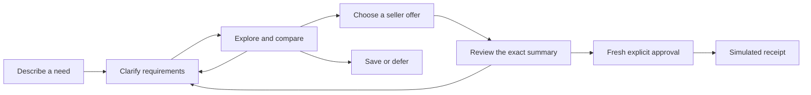

<div align="center">


### Find your next purchase. Talk it through.

A conversational shopping demo that keeps your needs, comparisons, and decisions in one place.

[](https://github.com/likalight/along/actions/workflows/ci.yml)
[](https://github.com/likalight/along/actions/workflows/catalog.yml)
[](https://github.com/likalight/along/actions/workflows/backend.yml)

[](./package.json)
[](./tsconfig.base.json)
[](./docker-compose.yml)
[](#project-status)
[](#human-approval)

[Quickstart](#quickstart) · [Try it](#try-a-shopping-journey) · [Development](#development-and-checks) · [Catalog](#catalog-and-provenance) · [Contribute](#contributing)

</div>

---

Shopping rarely follows a straight line. A review changes your mind, your budget shifts, or delivery tomorrow becomes more important than the lowest price.

**Along keeps that conversation together.** Explore a curated catalog, compare complete seller offers, revise your requirements, and explicitly confirm a simulated purchase. You can also save an option or decide not to buy.

Built for the Coupang challenge. The shopper interface, session backend, and text journey run today. Browser speech is available where supported; provider audio streaming remains unfinished. See [project status](#project-status) for the current boundaries.

## Quickstart

Clone the repository, then choose Docker or native Node.js:

```sh
git clone https://github.com/likalight/along.git
cd along
```

### Docker Compose

Requires **Docker Engine and Docker Compose v2**. Node.js is not required on the host.

```sh
docker compose up --build
```

Open [localhost:3000](http://127.0.0.1:3000) and choose **I'd rather type**. No API key or database is required for the text demo.

Stop with Ctrl+C, then `docker compose down`. Compose publishes port 3000 on the host; the container listens on all interfaces. For port changes and another device on the same network, see the [Docker demo guide](./docs/docker-demo.md).

### Native Node.js

Requires **Node.js 22.18+** and npm.

```sh
npm ci
npm run build
npm run start -w @along/shopper -- --port 4322
```

Open [localhost:4322](http://127.0.0.1:4322). The Next.js shopper calls the authoritative backend in the same process, so no separate backend server or agent token is needed.

## Try a shopping journey

Start in text mode and enter these messages in order:

1. `a work and gym bag`
2. `shape, budget USD 150`
3. `compare`
4. `show evidence`
5. `show offers`
6. `choose faster offer`
7. Read the complete summary, then type `confirm simulated purchase`.

Try `looks good` before the final confirmation: it must not create a receipt. Then enter `review summary`, reread the summary, and give fresh explicit confirmation. Changing the budget or delivery deadline also requires a new summary and fresh approval.

| Scenario | Opening request | What matters |
| --- | --- | --- |
| Audio for noisy cafés | “I dictate into my computer, but cafés are too noisy.” | Connection, wearability, portability, setup hardware, and total budget. |
| A bag for work and gym | “I like this shape. I need room for work and gym clothes.” | Laptop fit, capacity, shoe storage, total price, and delivery. |
| Bedsheets for a warm room | “Help me choose sheets for my bed.” | Actual mattress width, length and depth, composition, care, and included pieces. |

Conversation routing is bounded and deterministic. Prepared illustrations and supported product links provide context. The optional Chrome companion adds bounded discovery from supported public pages; arbitrary website crawling is not implemented.

### Discover while browsing

The [Along Chrome companion](./docs/extension.md) can notice products on enabled Amazon, TikTok, Instagram and YouTube desktop pages, show a small nudge, and open similar candidates in a side panel. Choose **Discuss with Along** to continue your existing conversation; drafts, pauses and the purchase-approval boundary are preserved.

Run `npm run build:extension`, then load `apps/extension/dist/along` through Chrome's **Load unpacked** control. Site access requires consent. **Demo mode is an explicit opt-in** with authored prices and Coupang search links. Set `ALONG_DISCOVERY_PROVIDER=search` with a server-side OpenAI key for real recognition and ordinary Coupang search links, without Partners credentials. Optional web search adds source-backed public product links with no price or stock claims. Direct Partners results still require approved credentials. Video and main post-photo interpretation require separate permission; recognition does not promise exact product identity. See the [setup, permissions and provider limitations](./docs/extension.md) before enabling it.

## What Along does

- **Preserves context.** Budget, delivery and compatibility requirements survive follow-up questions and changes of direction.
- **Keeps comparisons stable.** Numbered product cards, focus, saved items and comparisons use accepted product IDs.
- **Shows the complete offer.** Item cost, shipping, required setup hardware, tax, delivery and returns appear before approval.
- **Makes evidence inspectable.** Source facts, customer metrics, synthetic seller terms and unknown fields remain distinguishable.
- **Supports different inputs.** Text, browser speech, validated image uploads, prepared illustrations and allowlisted links feed the same session.
- **Provides accessible fallbacks.** Keyboard controls, transcripts, reduced motion and a CSS orb keep the interface usable without WebGL.

## How it works



The Next.js shopper renders accepted session snapshots. The agent adapter proposes actions, and the backend checks constraints, evidence, offer totals and approval before accepting them. The interface uses React, TypeScript, Motion for React and the vendored ElevenLabs UI Orb; the orb is a visual component.

### Human approval

A purchase summary identifies the product, variant, seller, quantity, destination, complete total, delivery, conditions and uncertainties.

- Material changes invalidate the previous summary and approval.
- Saving, selecting, “looks good,” attachments and assistant audio are not authorization.
- Text confirmation must be a fresh, deliberate instruction after the current summary is displayed.
- The backend voice contract additionally requires completed, uninterrupted playback and trusted shopper speech evidence. Provider voice approval is not yet an integrated, verified path; use explicit text confirmation for the demo.
- Retried approvals return the same simulated receipt.

**No payment is taken and no real merchant order is placed.**

## Configuration

Defaults are sufficient for the text demo.

| Variable | Used by | Purpose |
| --- | --- | --- |
| `OPENAI_API_KEY` | Next.js server / Compose | Optional: enables provider-secret minting and explicitly enabled discovery vision. It does not complete the provider audio transport. |
| `ALONG_PORT` | Docker Compose | Published host port; defaults to `3000`. The container still listens on port 3000. |
| `PLAYWRIGHT_PORT` | Browser tests | Isolated test-server port; defaults to `3000` for session tests and `4324` for the extension. |
| `CHROME_PATH` | Browser tests | Optional Chrome executable path instead of Playwright's installed Chromium. |

For Compose, copy [`.env.example`](./.env.example) to `.env` to override defaults (`cp .env.example .env`, or `Copy-Item .env.example .env` in PowerShell). For native development, provide server variables through the process environment or `apps/shopper/.env.local`. Keep keys server-side and out of version control.

Discovery is disabled by default. Its server flags, Coupang approval requirements and optional vision settings are documented in the [extension guide](./docs/extension.md#live-provider-configuration).

### Voice status

The app can mint a real provider client secret when configured. However, `LiveSpeechAdapter` currently uses browser recognition and speech synthesis; WebRTC audio negotiation is still pending. A successful mint or a “live” UI label does not establish a working provider audio stream.

Without a key, the mint endpoint returns `not_connected` and browser speech/text fallback remains available. Browser speech is half duplex: recognition pauses during narration. Support and microphone permissions depend on the browser. For a reproducible purchase rehearsal, use text mode.

## Development and checks

After the initial `npm ci` and `npm run build`:

```sh
# Shopper application
npm run dev -w @along/shopper -- --port 4322

# Optional diagnostic harness, in another terminal
npm run dev -w @coupang/web -- --port 4321
```

Root `npm run dev` starts the diagnostic harness. Backend and agent edits require rebuilding their workspace outputs before the Next.js apps consume them.

The [integration workflow](./.github/workflows/ci.yml) builds the workspaces and runs:

```sh
npm run typecheck
npm test -w @concierge/backend
npm test -w @coupang/agent
npm test -w @along/shopper
npm run test:extension
npx playwright install chromium
npm run test:e2e
npm run test:canvas
npm run test:extension:e2e
```

Root `npm test` runs only agent tests. Let Playwright start its own server on a free port: its managed server clears `OPENAI_API_KEY` so speech mocks exercise the fallback, while a reused server can have different settings. On Linux CI, browser installation also uses `--with-deps`.

Catalog and backend acceptance have their own checks:

```sh
npm ci --prefix catalog
npm run verify --prefix catalog
npm run verify -w @concierge/backend
```

When catalog source data changes, regenerate it with the catalog verification command, then run `npm run sync:catalog` and `npm run build` from the root. Commit the generated JSON and TypeScript modules together. Backend rehearsals emulate display/playback callbacks; passing them does not prove live speech recognition.

## Catalog and provenance

The catalog on main contains **24 active products and 48 synthetic seller offers**:

| Category | Active products |
| --- | ---: |
| Audio configurations | 12 |
| Everyday bags | 6 |
| Bedsheet sets | 6 |
| **Total** | **24** |

The full 50-record microphone research remains a separate archive. The active catalog includes 121 evidence records, three scenario sequences, supported source links and labelled illustrations.

| Data | Treatment |
| --- | --- |
| Product specifications and reference prices | Attributed snapshots or explicitly labelled estimates; source and price kind travel with the value. |
| Seller prices, stock, delivery and returns | Complete, explicitly synthetic offers for the fictional demo destination. |
| Customer ratings and review counts | Separate nullable fields; missing information stays unknown. |
| Café/office fit scores | Authored hypotheses, separate from customer ratings and measured performance. |
| Images and video | Illustrations are labelled proxy media; uncurated product videos remain missing. |

Catalog money is **USD in integer cents**. Reference item prices are separate from payable totals. Unknown laptop fit cannot satisfy a fit requirement, and unknown essential bedding details block checkout eligibility. External live discovery prices, when configured, are KRW snapshots and are not complete catalog offers.

The scenario clock is frozen at **24 October 2026, 10:00, Asia/Singapore**. Delivery dates are reproducible fixture inputs, not current shipping promises.

## Project layout

| Path | Responsibility |
| --- | --- |
| [`apps/shopper/`](./apps/shopper/) | Shopper UI, session API, attachments and speech adapters. |
| [`apps/extension/`](./apps/extension/) | Opt-in Chrome companion, automatic page observation and side panel. |
| [`apps/web/`](./apps/web/) | Diagnostic harness for backend/agent integration. |
| [`packages/agent/`](./packages/agent/) | Conversation routing, proposals, voice boundary and authoritative session adapter. |
| [`packages/contract/`](./packages/contract/) | Shared schemas, types and generated catalog module. |
| [`backend/`](./backend/) | Constraints, quotes, session state, approval and simulated receipts. |
| [`catalog/`](./catalog/) | Catalog source, research attribution, validators and scenario fixtures. |
| [`catalog/data/catalog.json`](./catalog/data/catalog.json) | Canonical active catalog consumed by the app. |
| [`catalog/data/microphones-archive.json`](./catalog/data/microphones-archive.json) | Full archived microphone research. |
| [`scripts/sync-catalog.mjs`](./scripts/sync-catalog.mjs) | Regenerates runtime adapters and copies illustration assets. |
| [`docs/docker-demo.md`](./docs/docker-demo.md) | Container setup and device-access instructions. |
| [`docs/extension.md`](./docs/extension.md) | Extension setup, permissions, provider gates and deployment boundaries. |

## Project status

Along is a hackathon prototype. This README describes the code on main; historical handoff documents may describe earlier isolated fixtures.

| Implemented | Boundary |
| --- | --- |
| Shopper shell and adaptive product canvas | Integrated text journey, stable comparisons and simulated receipts. |
| Authoritative session backend | In-memory, session-scoped access with a two-hour TTL; restarting the process loses sessions. |
| Catalog and provenance checks | Curated fixture data; no live retailer ingestion or inventory guarantees. |
| Image and link references | Validated uploads, prepared illustrations and supported source URLs; no general vision or unrestricted fetching. |
| Chrome discovery companion | Fixture demo, AI recognition/search links and optional source-backed public listing discovery; supported video/photo capture, no exact identity or current marketplace-data guarantee. |
| Browser speech and provider-secret minting | Browser-dependent speech; provider audio transport and trusted voice approval remain unfinished. |
| Docker Compose demo | One application process; no database or shared multi-instance session storage. |

Upcoming work includes the provider audio bridge and its live rehearsal, approved discovery-provider validation, durable sessions, and broader catalog ingestion. Real checkout, payment processing and mailbox integrations are outside this demo. Track work in [GitHub Issues](https://github.com/likalight/along/issues).

## Contributing

1. Read the [PRD](https://github.com/likalight/along/issues/1) and [integration contract](https://github.com/likalight/along/issues/2).
2. Choose an issue or propose a focused change in the [issue tracker](https://github.com/likalight/along/issues).
3. Preserve stable product IDs, source attribution, explicit unknowns and the distinction between observed and synthetic data.
4. Run the checks for affected workspaces and include validation results in your pull request.

Changes to approval, cancellation or offer eligibility should include both successful journeys and rejection cases. External content and model proposals never authorize a purchase.

## License

No repository-wide license has been selected. Public access alone does not grant an open-source license for reuse or distribution.

The vendored ElevenLabs UI Orb retains its own [MIT license](./apps/shopper/components/ui/elevenlabs-LICENSE.md). That component license does not license the rest of Along.

---

<div align="center">

**Along — a little conversation, a better choice.**

</div>
