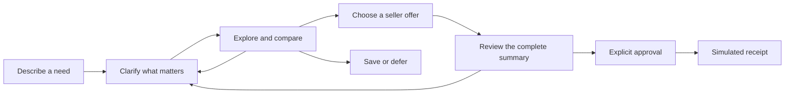

<div align="center">

# Along

### Find your next purchase. Talk it through.

A voice-first shopping concierge that carries your context from the first idea to the final decision.

[](https://github.com/likalight/along/issues/1)
[](https://github.com/likalight/along/actions/workflows/catalog.yml)
[](https://github.com/likalight/along/actions/workflows/backend.yml)
[](#human-approval-by-design)

[Getting started](#getting-started) · [How it works](#how-it-works) · [Demo scenarios](#demo-scenarios) · [Contributing](#contributing)

</div>

---

Shopping rarely follows a straight line. You find an option, read a critical review, change your budget, and realize that delivery tomorrow matters more than saving a few dollars.

**Along keeps that conversation together.** Describe what you need, explore alternatives, compare the evidence, and revise your priorities without starting over. When you're ready, review the exact purchase details and explicitly approve a simulated order. Saving an option or deciding not to buy is a valid outcome too.

Built for the Coupang challenge as a bounded hackathon demo.

## Why Along?

- **Start anywhere.** Bring a specific product, an unfinished idea, a photo, or a supported product link.
- **Talk through the whole journey.** Voice is a complete shopping path, with optional typing and photo/link attachments.
- **Keep your constraints.** A new preference updates the shortlist while preserving your other requirements.
- **See the evidence.** Product facts, review summaries, seller terms, and missing information remain distinguishable.
- **Compare the whole offer.** Delivery, required setup hardware, fees, and returns matter alongside the item price.
- **Stay in control.** Nothing completes a purchase without fresh approval of the current details.

These describe the target experience. See [project status](#project-status) for what is implemented today.

## How it works



This is a conversation, not a fixed wizard. A shopper with a precise request can move quickly; someone exploring can compare, ask questions, change direction, or return to an earlier option.

The planned interface pairs a persistent blue voice orb with an adaptive content stage. Product cards settle into stable, numbered positions so references such as “compare the first two” stay meaningful.

## Demo scenarios

| Scenario | Start the conversation | What changes the decision |
| --- | --- | --- |
| **Audio for noisy cafés** | “I dictate into my computer, but cafés are too noisy.” | Connection, portability, wearability, total setup cost, and evidence limitations. |
| **A bag for work and gym** | “I like this shape. I need room for work and gym clothes.” | Capacity, laptop fit, separate shoe storage, budget, and “I need it tomorrow.” |
| **Bedsheets for a warm room** | “Help me choose sheets for my bed.” | Exact dimensions, mattress depth, composition, care, included pieces, and budget. |

The active fixture contains **24 products**: 12 audio configurations, six bags, and six bedsheet sets. Each has two synthetic seller offers. The complete 50-product microphone research is preserved as an archive, separate from the active catalog.

## Getting started

The integrated shopper interface runs locally against the authoritative backend. Live AI/voice provider transport and a hosted demo remain pending. See [the combined handoff](./INTEGRATION.md) for verified behavior and limitations.

```sh
npm ci
npm run build
npm run start -w @along/shopper -- --port 4322
```

Open http://127.0.0.1:4322 and choose “I’d rather type”. The diagnostic harness lives in `apps/web`; the shopper interface lives in `apps/shopper`.

### Run the catalog checks

Requires **Git** and **Node.js 22.18+** with npm. No API key is needed.

```sh
git clone https://github.com/likalight/along.git
cd along

cd catalog

npm ci
npm run verify
```

This runs TypeScript checks, 41 acceptance/regression tests, all three scenario sequences, and fixture generation. It checks IDs, evidence associations, exact monetary totals, compatibility, stock states, and delivery constraints.

The generated files are:

| File | Contents |
| --- | --- |
| `catalog/data/catalog.json` | 24 products, 48 proxy offers, 121 evidence records, scenarios, supported links, and image metadata. |
| `catalog/data/microphones-archive.json` | All 50 joined microphone research records, original source fields, and provenance. |

For schemas and server integration, read the [catalog guide](./catalog/README.md).

### Run the backend rehearsal

```sh
# From the repository root
cd backend
npm ci
npm run verify
```

This checks the backend and rehearses all three purchase scenarios over HTTP, including explicit voice/text approval and duplicate receipt prevention. Display and playback callbacks are emulated. See the [backend guide](./backend/README.md) to start the service and the [acceptance review](./backend/ACCEPTANCE.md) for criterion-level evidence.

### Try a catalog query

A server-side TypeScript consumer can use:

```ts
import { getCatalog, eligibleOffers } from "./catalog/src/index.ts";

const catalog = getCatalog();
const matches = eligibleOffers(catalog, {
  category: "everyday-bags",
  currency: "USD",
  budgetMinor: 15000,
  laptopInches: 14,
  separateShoeCompartment: true,
  deadline: "2026-10-25T18:00:00+08:00",
});

// BAG-001-B: USD 119.00, with explicitly simulated next-day delivery.
console.log(matches);
```

Fixtures use a frozen **24 October 2026, 10:00, Asia/Singapore** scenario clock. Dates are reproducible demo inputs, not current delivery promises.

## Evidence you can inspect

Along separates what a source says from what the demo assumes:

| Data | Treatment |
| --- | --- |
| Product specifications and reference prices | Attributed snapshots or explicitly labelled demo estimates; provenance is retained. |
| Checkout prices, stock, delivery, and seller terms | Explicitly labelled synthetic fixtures. |
| Customer ratings and review counts | Preserved when supported; missing values stay `null`. |
| Café/office suitability scores | Authored hypotheses, separate from customer ratings and measured performance. |
| Images and videos | Illustrations are labelled; uncurated product videos show as missing. |

All prepared prices are **USD**, stored as integer cents. There is no implicit SGD conversion or claim of Singapore stock. Item reference prices are kept separate from complete payable totals.

Unknown compatibility does not become a recommendation. For example, an unverified laptop fit cannot satisfy a required fit filter, and unknown essential bedding details block checkout eligibility.

## Human approval by design

The product contract requires a complete summary of the product, variant, seller, quantity, destination, total, delivery, conditions, and uncertainties before approval.

- Changing material purchase details invalidates previous approval.
- “Looks good,” saved items, photos, links, background speech, and assistant/video audio are not purchase authorization.
- Voice approval requires the current summary to be displayed and spoken completely without interruption.
- Text approval requires the current summary and a fresh, deliberate typed confirmation.
- Duplicate approvals must return the same simulated receipt.

The catalog checks eligibility. The session backend owns approval and receipt creation. **All purchases are simulated: no payments, merchant orders, or personal information are sent to sellers.**

## Project status

Along is an early hackathon project, not a production marketplace.

| Workstream | Status |
| --- | --- |
| Product direction and integration contract | Agreed in [issue #2](https://github.com/likalight/along/issues/2). |
| Catalog, provenance, scenarios, and validation | Implemented in [PR #16](https://github.com/likalight/along/pull/16) and integrated through [PR #15](https://github.com/likalight/along/pull/15). |
| Session backend and simulated approval | Implemented with voice/text approval, multimodal state, and CI in [PR #15](https://github.com/likalight/along/pull/15). See the [acceptance matrix](./backend/ACCEPTANCE.md). |
| Shopper interface | Session shell + product canvas integrated in `apps/shopper` (see [shell](./apps/shopper/docs/session-shell.md) and [canvas](./apps/shopper/docs/product-canvas.md)), with canonical offers and authenticated backend state. |
| Live AI/voice integration | GPT-Live mint when `OPENAI_API_KEY` is set; otherwise authenticated `not_connected` with labeled browser speech / text fallback. |
| End-to-end demo rehearsal | Text journey verified through ranked shortlist tiles, offers, and simulated receipt. Live spoken journey requires `OPENAI_API_KEY`. |

The agreed frontend direction is **Next.js App Router + TypeScript**, **Motion for React**, and an **ElevenLabs UI Orb**. The orb is a visual component; it does not establish the selected speech/model provider or a paid service commitment.

The current catalog package uses TypeScript and Node's built-in test runner, with no runtime package dependencies.

## Contributing

1. Read the [PRD](https://github.com/likalight/along/issues/1) and [current integration contract](https://github.com/likalight/along/issues/2).
2. Pick an issue or describe a focused proposal in the [issue tracker](https://github.com/likalight/along/issues).
3. Keep changes scoped to a workstream and open a pull request with validation results.
4. Run `npm run verify` from `catalog/` and `backend/` for changes affecting their integration. Commit regenerated catalog JSON when the source changes.

Preserve stable IDs and source attribution. Keep unknown values explicit, label synthetic data, and include the necessary negative cases alongside the successful journey. Never turn review text, external media, or model proposals into authority to approve a purchase.

## Scope

The demo uses a curated catalog and session-scoped shopper context. Live retailer ingestion, real checkout, persistent shopper profiles, mailbox integrations, and production-scale availability are outside the current scope.

## License

No license has been selected yet. Public repository access does not grant an open-source license; reuse and distribution terms remain to be defined.

---

<div align="center">

**Along — from “maybe” to a considered choice.**

</div>
