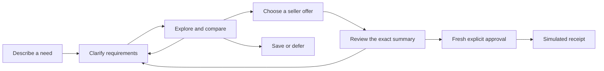

<div align="center">


### Find your next purchase. Talk it through.

A conversational shopping demo that keeps your needs, comparisons, and decisions in one place.

[](https://github.com/likalight/along/actions/workflows/ci.yml)
[](https://github.com/likalight/along/actions/workflows/catalog.yml)
[](https://github.com/likalight/along/actions/workflows/backend.yml)

[](./package.json)
[](./tsconfig.base.json)
[](./docker-compose.yml)
[](#project-status)
[](#human-approval)

[Quickstart](#quickstart) · [Try it](#try-a-shopping-journey) · [Development](#development-and-checks) · [Catalog](#catalog-and-provenance) · [Contribute](#contributing)

</div>

---

Shopping rarely follows a straight line. A review changes your mind, your budget shifts, or delivery tomorrow becomes more important than the lowest price.

**Along keeps that conversation together.** Explore a curated catalog, compare complete seller offers, revise your requirements, and explicitly confirm a simulated purchase. You can also save an option or decide not to buy.

Built for the Coupang challenge. The shopper interface, authoritative session backend, open-ended text shopping and GPT-Live voice conversation run today. A server-side OpenAI API key is required for conversational shopping. See [project status](#project-status) for the current boundaries.

## Unified Mac + Chrome demo

For the judging walkthrough, build once with `npm run build`, then run `npm run demo`. Open [Along setup](http://127.0.0.1:4339/setup) in desktop Chrome. This uses the Mac companion’s saved preferences and the Chrome extension in one shopping conversation. See the [seven-minute demo and permission checklist](docs/unified-demo.md).

## Quickstart

Clone the repository, then choose Docker or native Node.js:

```sh
git clone https://github.com/likalight/along.git
cd along
```

### Docker Compose

Requires **Docker Engine and Docker Compose v2**. Node.js is not required on the host.

```sh
docker compose up --build
```

Open [localhost:3000](http://127.0.0.1:3000) and choose **Type instead** or **Start talking**. Configure `OPENAI_API_KEY` in the root `.env` before starting Compose to use conversational shopping and voice. No database is required; without a key, the interface loads but the live agent cannot answer shopping requests.

Stop with Ctrl+C, then `docker compose down`. Compose publishes port 3000 on the host; the container listens on all interfaces. For port changes and another device on the same network, see the [Docker demo guide](./docs/docker-demo.md).

### Native Node.js

Requires **Node.js 22.18+** and npm. Set `OPENAI_API_KEY` in the ignored `apps/shopper/.env.local` for conversational shopping and voice. See [local voice setup](./apps/shopper/docs/live-voice.md) and [the combined handoff](./INTEGRATION.md). A hosted demo remains pending.

```sh
npm ci
npm run build
npm run start -w @along/shopper -- --port 4322
```

Open [localhost:4322](http://127.0.0.1:4322). The Next.js shopper calls the authoritative backend in the same process, so no separate backend server or agent token is needed.

## Try a shopping journey

Start in text mode and enter these messages in order:

1. `a work and gym bag`
2. `shape, budget USD 150`
3. `compare`
4. `show evidence`
5. `show offers`
6. `choose faster offer`
7. Read the complete summary, then say or type `Yes, go ahead and place the order`, or answer the current order-approval question with `yes please`.

No special confirmation word is required. A short assent only authorizes the current reviewed order when it answers the order-approval question; saying `looks good` while browsing products or answering an unrelated question must not create a receipt. Changing the budget or delivery deadline requires a new summary and fresh approval.

| Scenario | Opening request | What matters |
| --- | --- | --- |
| Audio for noisy cafés | “I dictate into my computer, but cafés are too noisy.” | Connection, wearability, portability, setup hardware, and total budget. |
| A bag for work and gym | “I like this shape. I need room for work and gym clothes.” | Laptop fit, capacity, shoe storage, total price, and delivery. |
| Bedsheets for a warm room | “Help me choose sheets for my bed.” | Actual mattress width, length and depth, composition, care, and included pieces. |

The open-ended agent chooses validated shopping tools within bounded execution limits. Simple UI commands and checkout approval retain direct server handlers. Prepared illustrations and supported product links provide context; the optional Chrome companion adds bounded visual discovery on supported public pages. See the [shopping harness](./apps/shopper/docs/open-ended-harness.md) for routing and guardrails.

See the [judging evidence and seven-minute demo](./docs/judging-demo.md) for the challenge answers and an honest live-platform validation matrix.

### Discover while browsing

The [Along Chrome companion](./docs/extension.md) can notice products on enabled Amazon, TikTok, Instagram and YouTube desktop pages, show a small nudge, and open similar candidates in a side panel. Choose **Discuss with Along** to continue your existing conversation; drafts, pauses and the purchase-approval boundary are preserved.

Run `npm run build:extension`, then load `apps/extension/dist/along` through Chrome's **Load unpacked** control. Site access requires consent. **Demo mode is an explicit opt-in** with authored prices and Coupang search links. Set `ALONG_DISCOVERY_PROVIDER=search` with a server-side OpenAI key for real recognition and ordinary Coupang search links, without Partners credentials. Optional web search adds source-backed public product links with no price or stock claims. Direct Partners results still require approved credentials. Video and main post-photo interpretation require separate permission; recognition does not promise exact product identity. See the [setup, permissions and provider limitations](./docs/extension.md) before enabling it.

## What Along does

- **Preserves context.** Budget, delivery and compatibility requirements survive follow-up questions and changes of direction.
- **Keeps comparisons stable.** The React Bits circular carousel, focus, saved items and comparisons use accepted product IDs; live speech can focus the product being discussed.
- **Shows the complete offer.** Item cost, shipping, required setup hardware, tax, delivery and returns appear before approval.
- **Makes evidence inspectable.** Source facts, customer metrics, synthetic seller terms and unknown fields remain distinguishable.
- **Supports different inputs.** Text, GPT-Live speech, validated image uploads, prepared illustrations and allowlisted links feed the same session.
- **Provides accessible fallbacks.** Keyboard controls, transcripts, reduced motion and a CSS orb keep the interface usable without WebGL.

## How it works



The Next.js shopper renders accepted session snapshots. The agent adapter proposes actions, and the backend checks constraints, evidence, offer totals and approval before accepting them. The interface uses React, TypeScript, Motion for React and the vendored ElevenLabs UI Orb; the orb is a visual component.

### Human approval

A purchase summary identifies the product, variant, seller, quantity, destination, complete total, delivery, conditions and uncertainties.

- Material changes invalidate the previous summary and approval.
- Saving, product selection, attachments and assistant audio are not authorization.
- Natural purchase requests require the current displayed summary. Short assent such as “yes please” additionally requires a pending order-approval question bound to that summary.
- The strict voice contract still requires completed, uninterrupted playback and trusted shopper speech evidence. GPT-Live transcript fragments do not satisfy those requirements: this no-payment prototype uses a separate server-only completion path bound to the displayed summary, revision, response turn and eligible proxy offer. It cannot authorize payment or a real merchant order. See [purchase boundaries](./apps/shopper/docs/live-voice.md#purchase-boundary).
- Retried approvals return the same simulated receipt.

**No payment is taken and no real merchant order is placed.**

## Configuration

An OpenAI API key with access to the configured models is required for live text and voice shopping. Scripted routing remains available to automated offline tests; provider failures do not silently fall back to it.

| Variable | Used by | Purpose |
| --- | --- | --- |
| `OPENAI_API_KEY` | Next.js server / Compose | Enables the Responses API shopping harness and GPT-Live voice connection. Keep it server-side. |
| `ALONG_AGENT_MODEL`, `ALONG_AGENT_REASONING_EFFORT`, `ALONG_AGENT_SERVICE_TIER` | Next.js server | Optional model-routing overrides for operator testing; see [model routing](./apps/shopper/docs/live-voice.md#model-routing). |
| `ALONG_PORT` | Docker Compose | Published host port; defaults to `3000`. The container still listens on port 3000. |
| `PLAYWRIGHT_PORT` | Browser tests | Isolated test-server port; defaults to `3000` for session tests and `4324` for the extension. |
| `CHROME_PATH` | Browser tests | Optional Chrome executable path instead of Playwright's installed Chromium. |

For Compose, copy [`.env.example`](./.env.example) to `.env` to override defaults (`cp .env.example .env`, or `Copy-Item .env.example .env` in PowerShell). For native development, provide server variables through the process environment or `apps/shopper/.env.local`. Keep keys server-side and out of version control.

Discovery is disabled by default. Its server flags, Coupang approval requirements and optional vision settings are documented in the [extension guide](./docs/extension.md#live-provider-configuration).

### Voice status

The shopper uses `gpt-live-1` over WebRTC with microphone input, provider audio playback and an authenticated server sideband that delegates shopping work to the same harness as text mode. The microphone stays active during replies; local playback yields to interruptions while new constraints supersede obsolete work. The carousel follows recognized product names in live assistant captions.

Research and recommendations involving several criteria request GPT-6.1 Sol with low reasoning and Fast processing; routine work uses GPT-6 Luna. Fast mode is a requested provider tier, not a latency guarantee. Connection failures and recoverable shopping limits are surfaced. Human microphone tests are still needed to assess interruption timing, acoustic false triggers and conversational smoothness; automated tests do not establish those qualities. See [voice setup, rehearsal and limits](./apps/shopper/docs/live-voice.md).

## Development and checks

After the initial `npm ci` and `npm run build`:

```sh
# Shopper application
npm run dev -w @along/shopper -- --port 4322

# Optional diagnostic harness, in another terminal
npm run dev -w @coupang/web -- --port 4321
```

Root `npm run dev` starts the diagnostic harness. Backend and agent edits require rebuilding their workspace outputs before the Next.js apps consume them.

The [integration workflow](./.github/workflows/ci.yml) builds the workspaces and runs:

```sh
npm run typecheck
npm test -w @concierge/backend
npm test -w @coupang/agent
npm test -w @along/shopper
npm run test:extension
npx playwright install chromium
npm run test:e2e
npm run test:canvas
npm run test:extension:e2e
```

Root `npm test` runs only agent tests. Playwright starts its own development server on a free port (`PLAYWRIGHT_PORT`, default 3000), using `.next-e2e` build output. It clears `OPENAI_API_KEY` and explicitly selects the offline fixture agent so browser journeys and speech mocks do not call paid providers. It never reuses a running live demo; production does not accept fixture mode. On Linux CI, browser installation also uses `--with-deps`.

Catalog and backend acceptance have their own checks:

```sh
npm ci --prefix catalog
npm run verify --prefix catalog
npm run verify -w @concierge/backend
```

When catalog source data changes, regenerate it with the catalog verification command, then run `npm run sync:catalog` and `npm run build` from the root. Commit the generated JSON and TypeScript modules together. Backend rehearsals emulate display/playback callbacks; passing them does not prove live speech recognition.

## Catalog and provenance

The catalog contains **200 active products and 400 synthetic seller offers**:

| Category | Active products |
| --- | ---: |
| Audio configurations | 100 |
| Everyday bags | 50 |
| Bedsheet sets | 50 |
| **Total** | **200** |

The full 100-record microphone research is also retained as an archive. The active catalog includes 1,234 evidence records, three scenario sequences, supported source links, 148 source-attributed product photographs and 52 labelled illustration fallbacks. Your portion contains 50 bags and 50 bedding sets, alongside the 100 audio configurations. The catalog also includes 800 explicitly authored demo reviews.

| Data | Treatment |
| --- | --- |
| Product specifications and reference prices | Attributed snapshots or explicitly labelled estimates; source and price kind travel with the value. |
| Seller prices, stock, delivery and returns | Complete, explicitly synthetic offers for the fictional demo destination. |
| Customer ratings and review counts | Source metrics remain separate nullable fields; missing information stays unknown. Authored demo review entries are separate synthetic data. |
| Café/office fit scores | Authored hypotheses, separate from customer ratings and measured performance. |
| Images and video | Product photographs retain manufacturer or retailer source metadata; illustration fallbacks remain proxy media. Uncurated product videos remain missing. |

Catalog money is **USD in integer cents**. Reference item prices are separate from payable totals. Unknown laptop fit cannot satisfy a fit requirement, and unknown essential bedding details block checkout eligibility. External live discovery prices, when configured, are KRW snapshots and are not complete catalog offers.

The scenario clock is frozen at **24 October 2026, 10:00, Asia/Singapore**. Delivery dates are reproducible fixture inputs, not current shipping promises.

## Project layout

| Path | Responsibility |
| --- | --- |
| [`apps/shopper/`](./apps/shopper/) | Shopper UI, session API, attachments and speech adapters. |
| [`apps/extension/`](./apps/extension/) | Opt-in Chrome companion, automatic page observation and side panel. |
| [`apps/web/`](./apps/web/) | Diagnostic harness for backend/agent integration. |
| [`packages/agent/`](./packages/agent/) | Conversation routing, proposals, voice boundary and authoritative session adapter. |
| [`packages/contract/`](./packages/contract/) | Shared schemas, types and generated catalog module. |
| [`backend/`](./backend/) | Constraints, quotes, session state, approval and simulated receipts. |
| [`catalog/`](./catalog/) | Catalog source, research attribution, validators and scenario fixtures. |
| [`catalog/data/catalog.json`](./catalog/data/catalog.json) | Canonical active catalog consumed by the app. |
| [`catalog/data/microphones-archive.json`](./catalog/data/microphones-archive.json) | Full archived microphone research. |
| [`scripts/sync-catalog.mjs`](./scripts/sync-catalog.mjs) | Regenerates runtime adapters and copies catalog media assets. |
| [`docs/docker-demo.md`](./docs/docker-demo.md) | Container setup and device-access instructions. |
| [`docs/extension.md`](./docs/extension.md) | Extension setup, permissions, provider gates and deployment boundaries. |

## Project status

Along is a hackathon prototype. This README describes the code on main; historical handoff documents may describe earlier isolated fixtures.

| Implemented | Boundary |
| --- | --- |
| Shopper shell and circular product carousel | Integrated text and voice journeys, stable comparisons and simulated receipts. |
| Authoritative session backend | In-memory, session-scoped access with a two-hour TTL; restarting the process loses sessions. |
| Catalog and provenance checks | Curated fixture data; no live retailer ingestion or inventory guarantees. |
| Image and link references | Validated uploads, prepared illustrations and supported source URLs; no general vision or unrestricted fetching. |
| Chrome discovery companion | Fixture demo, AI recognition/search links and optional source-backed public listing discovery; supported video/photo capture, no exact identity or current marketplace-data guarantee. |
| GPT-Live conversation and delegated shopping | WebRTC audio and server sideband are integrated; interruption quality needs human acoustic testing. Live demo completion remains separate from strict verified voice approval. |
| Natural checkout approval | Clear purchase requests and context-bound assent complete the current reviewed order; rejection preserves the review. |
| Docker Compose demo | One application process; no database or shared multi-instance session storage. |

Upcoming work includes further live voice rehearsal and latency tuning, broader discovery-platform validation, approved retailer data, and durable sessions. Real checkout, payment processing and mailbox integrations are outside this demo. Track work in [GitHub Issues](https://github.com/likalight/along/issues).

## Contributing

1. Read the [PRD](https://github.com/likalight/along/issues/1) and [integration contract](https://github.com/likalight/along/issues/2).
2. Choose an issue or propose a focused change in the [issue tracker](https://github.com/likalight/along/issues).
3. Preserve stable product IDs, source attribution, explicit unknowns and the distinction between observed and synthetic data.
4. Run the checks for affected workspaces and include validation results in your pull request.

Changes to approval, cancellation or offer eligibility should include both successful journeys and rejection cases. External content and model proposals never authorize a purchase.

## License

No repository-wide license has been selected. Public access alone does not grant an open-source license for reuse or distribution.

The vendored ElevenLabs UI Orb retains its own [MIT license](./apps/shopper/components/ui/elevenlabs-LICENSE.md). That component license does not license the rest of Along.

---

<div align="center">

**Along — a little conversation, a better choice.**

</div>
