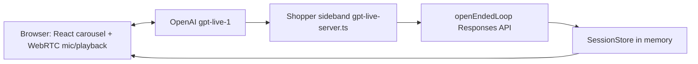

# Along voice-shopping harness — code fact brief

Grounded in the repository on 27 October 2026. This is a fact sheet for rewriting the Medium draft, not a product change. Claims below are what the current tree does. Historical bugs in the draft are marked as history when the current code only preserves the regression, not the bug.

Checkout and seller offers are simulated. Along was the Coupang-challenge team build; a sixth-place individual finish is author context and is not encoded in the repo.

## 1. High-level architecture

One Node process is the shopper. `apps/shopper` is a Next.js App Router app. On first use, `apps/shopper/lib/integration/runtime.ts` constructs, on `globalThis`:

- `AuthoritativeSessionStore` — adapter over the in-process backend store
- `VoiceOrchestrator` — turn machine plus either the open-ended Responses loop or the scripted router
- `GptLiveVoiceAdapter` — server-side voice bookkeeping for that orchestrator

The browser does not hold the shopping record. It renders the projected snapshot and, in voice mode, opens a WebRTC call.

**Realtime voice path**

1. `POST /api/voice/mint` only checks that `OPENAI_API_KEY` is set. It does not open a provider session (`apps/shopper/app/api/voice/mint/route.ts`).
2. If the key is present, `createSpeechAdapter` returns `GptLiveAdapter` (`apps/shopper/lib/voice/create-speech-adapter.ts`). The browser posts an SDP offer to `POST /api/voice/live/connect`.
3. `connectGptLive` creates an OpenAI Live session with model `gpt-live-1`, voice `marin` by default (`cedar` and `coral` are the other allowed voices), `store: false`, and **client delegation** (`apps/shopper/lib/voice/gpt-live-server.ts`). The browser sends microphone audio and plays the provider audio track.
4. An authenticated server WebSocket sideband receives transcript fragments and `session.delegation.created` events whose target is `client`. The sideband, not the browser and not the Live model, calls the shopping harness.

**Shopping agent**

Production (`NODE_ENV` other than the fixture rules below) passes an `OpenEndedAgentConfig` into `VoiceOrchestrator`. Each delegated or typed turn calls `openEndedLoop`, which posts to `https://api.openai.com/v1/responses` with `shoppingTools`, `parallel_tool_calls: false`, `store: false`, a 90-second deadline, at most eight model iterations, and `max_output_tokens: 4096` (`packages/agent/src/orchestrator/openEndedLoop.ts`).

The scripted `agentLoop` plus keyword `routeInput` run only when:

- `NODE_ENV=test` and `ALONG_AGENT_MODE` is not `live`, or
- `NODE_ENV=development` and `ALONG_AGENT_MODE=fixture`.

Playwright sets the second case and clears `OPENAI_API_KEY` (`apps/shopper/playwright.config.ts`). A missing key or a provider error in production does **not** fall through to the scripted router. The loop throws `shopping_agent_not_configured` or `shopping_agent_provider_error_<status>`.

`apps/web` is a separate diagnostic console. Its runtime constructs `VoiceOrchestrator` **without** an open-ended agent config (`apps/web/src/server/runtime.ts`), so that app stays on the keyword router. It is not the shopper demo.

**Server of record**

`backend/src/store.ts` `SessionStore` is the authority: constraints, shortlist, selection, summary, receipt, revision, epoch. The shopper imports it in-process through `AuthoritativeSessionStore` (`packages/agent/src/session/AuthoritativeSessionStore.ts`). `backend/src/server.ts` can also expose the same store over HTTP for the older bridge; the integrated demo does not require that process. There is no database.



## 2. Shopping record and who may mutate it

There are two views of one session.

**Backend `Session`** (`backend/src/contracts.ts`): `needs`, `constraints` (budget, delivery, compatibility, capacity, shoe compartment, `shopperHandledConnectionFor`), `preferences` (stringified pairs), `excludedProductIds`, `shortlist`, `displayOrder`, `view` (cards, focus, stage), `comparisonIds`, `savedItems`, `selection` (`offerId` + `quantity`), `summary`, `receipt`, `turn`, `revision`, `epoch`, `stage`, `presentationMode`, `destination`, `history`, `attachmentIds`, `priority`, `evidenceIds`.

**Projected `SessionSnapshot`** (`packages/contract/src/types.ts`): the same ideas under agent/UI names (`hardConstraints`, `shortlistIds`, `shortlistEntries`, `focusedProductId`, `selectedOfferId`, `approvalStatus`, `view`). `AuthoritativeSessionStore.get` builds this projection. The React canvas reads the projection. It does not invent accepted product IDs locally.

**Acceptance rules**

- `SessionStore.propose` validates a **clone**, then commits. A rejected proposal does not partially update the live session (`backend/src/store.ts`, around the `propose` method; regression in `backend/test/proposal-atomicity.test.ts`).
- `expectedRevision` must match. Stale revisions return 409 `STALE_REVISION`.
- Actions must target the active turn. Cancelled or superseded turns return `STALE_TURN`.
- `once(session, epoch, eventId, payload)` dedupes successful operations. Reusing an event id with a different payload conflicts. Failures are not cached.
- Quantity other than one is rejected. Money is USD integer cents. The scenario clock is frozen at 24 October 2026, 10:00, Asia/Singapore (`backend/README.md`, catalog profile).
- A material proposal invalidates the previous summary and its approval window (`invalidate`).
- After a receipt, `mutable()` refuses further shopping mutations with `ORDER_COMPLETE`.
- Sessions expire after **two hours** (`ttlMs = 2 * 60 * 60 * 1000`), cap at **200** sessions, and vanish on process restart. Photos stay in memory (max five PNG/JPEG/WebP, 2 MiB each, on the backend profile).

**Who may mutate**

| Actor | May change | May not |
| --- | --- | --- |
| Open-ended model, via shopping tools | Requirements, shortlist, focus, comparison, evidence, save/restore, offer selection, summary preparation | Purchase approval. `propose_approval` throws. |
| Exact UI command strings in `apps/shopper/app/api/session/route.ts` | Focus, save, compare, select offer, prepare summary, navigation shortcuts | These are server handlers, not model tools. |
| Checkout interpreter | Nothing. It returns a JSON decision. | It has no tools and cannot set prices or receipts. |
| `approve()` | Simulated receipt, only with a fresh matching turn, displayed summary, approval nonce, and trusted evidence | Live transcript fragments. |
| `completeLiveDemo` | Simulated receipt with `completionSource: "live_demo"`, server sideband only | Payment, merchant orders, non-proxy offers. Not an HTTP action and not a model tool. |
| Mac memory init | Soft bag preferences on an **unused** session (`revision === 0`, no history, turn, receipt, or preferences) | Budget, fit, approval, checkout. Active sessions are not overwritten. |

## 3. Tool surface

Defined in `packages/agent/src/tools/shoppingTools.ts` as strict JSON-schema functions. The model picks any order. The server executes them. Tool results are data for the next model turn, not instructions.

| Tool | What it does | Server gate |
| --- | --- | --- |
| `show_solution_types` | Optional compact mic chooser: headset, clip-on, desk. Sets stage `solution_types` and `audioDirectionPending`. | Does not shortlist products in the same turn as a choice. |
| `choose_solution_type` | Remembers `headset`, `clip_on`, `directional_desktop`, or `any`. | Refused if `show_solution_types` already ran in this turn. `any` is the skip. |
| `search_catalog` | Ranks up to 12 products. Returns quotes, `budgetStatus`, conflicts, `nextOffset`. **Does not change the canvas.** | IDs come from the fixture catalog. `eligible` means checkout-ready, not “within budget”. |
| `inspect_product` | Facts, evidence, full quotes for one id. | Unknown facts stay unknown. No state change. |
| `remember_requirements` | Needs, preferences, exclusions, budget cents, category, delivery days, capacity, shoe compartment, compatibility. Null leaves a field unchanged. | Budget **increases**, longer delivery, lower capacity, and dropping the shoe compartment require an explicit shopper sentence. See section 5. |
| `remember_connection_setup` | Adds or removes this product id in `shopperHandledConnectionFor`. | Audio products only. Does not set the host port, waive budget, or approve. |
| `set_priority` | `best_value`, `best_supported_quality`, or `lowest_cost_suitable`. | Does not remove a hard budget. |
| `shortlist` | Proposes up to five ids with fit reason and compromise. | Store drops hard conflicts, keeps soft ones (unknown connector, over budget, unknown bed size), writes `displayOrder` and cards. Max five, distinct ids. |
| `compare` | Two to four ids that are already visible. | |
| `navigate_products` | Next, previous, first, last, or 1-based position. | Focus only. Wraps. Does not reorder, select an offer, or buy. |
| `focus` | Focus one visible product. | |
| `show_evidence` | Show catalog evidence ids. | |
| `save` / `restore` | Save for later, or restore and recheck. | Not a purchase. |
| `select_offer` | Selects one offer, quantity forced to 1. | Ineligible, over-budget, or unknown-id offers are rejected. Does not purchase. |
| `prepare_summary` | Builds the server’s exact spoken review and stops the model turn (`canonicalSummary`). | If `productId` is set and `offerId` is null, the server picks the lowest `total` among **eligible** quotes, then delivery days, then offer id. Both null summarizes the already selected offer. The model is not allowed to rewrite that text. |

**Not tools:** `approve`, payment, web browsing, vision, and `propose_approval`. The last exists as a proposal action only so the store can reject it:

```482:485:packages/agent/src/session/AuthoritativeSessionStore.ts
          case "propose_approval":
            throw new Error(
              "Model proposals cannot authorize a purchase. Display the exact summary, then use a new explicit shopper confirmation.",
            );
```

Checkout interpretation is a second Responses call with `tools` omitted (`apps/shopper/lib/checkout/intent.ts`).

## 4. Interruptions: yield, cancel, obsolete results

Three different mechanisms. Mixing them up is how replies disappeared.

**Audio yield (browser).** `GptLiveAdapter` keeps the microphone track during assistant speech. `LivePlaybackGate` (`apps/shopper/lib/voice/live-playback-gate.ts`) mutes **local playback** after 200 ms of sustained input above an adaptive threshold (`max(0.012, noiseFloor * 3.5, output * 0.22)` while not already muted). Echo cancellation is requested; the gate is still a heuristic. Brief acknowledgments (`mm-hm`, `yeah`, `ok`, …) do not request a yield by themselves (`requestsPlaybackYield` in `gpt-live-adapter.ts`). A short correction that starts with `no`, `wait`, `stop`, `actually`, `but`, `hold on`, or `hang on`, or any caption of at least three words, can request a yield before the 200 ms dwell.

The media element keeps playing silently so old WebRTC audio can drain. It is not replayed. A reply that starts during the 100 ms end pause is remembered and released only after the stop request is accepted and input has been quiet. A caption timestamped after the shopper can qualify on a 50 ms remote gap; without that timestamp the gate wants a 120 ms gap plus fresh text, or a 600 ms gap with no text. Manual stop stays muted until new shopper input. The code comments that GPT-Live has no output-turn completion event, so this cannot prove the resumed audio is a new answer.

**Cancel work (server turn).** `TurnMachine` aborts the previous turn when a new orchestrator turn begins (`packages/agent/src/orchestrator/TurnMachine.ts`). `openEndedLoop` returns `{ cancelled: true }` when that `AbortSignal` fires, and does not publish the speakable. On the Live sideband, `delegate()` calls `orch.bargeIn` only when a task is pending **and** the call is not preserving a displayed order review (`preserveReview` in `gpt-live-server.ts`). “Wait” can yield audio while shopping work continues. Typed input goes through `VoiceOrchestrator.handleInput`, which cancels the active turn before the text path.

**Obsolete results.** Each delegation bumps `call.generation`. After the shopping POST returns, the sideband drops the commentary if `generation` changed, the call closed, or the store’s current turn id is no longer this delegation’s turn. A transcript that arrives during checkout interpretation is not consumed; the sideband says it will hold the order and waits for the next delegation. Validation errors that happen **before** a new turn is created are still spoken: the prior turn still owns the unchanged summary, and silence is treated as a bug (`gpt-live-server.ts` catch path).

```546:552:apps/shopper/lib/voice/gpt-live-server.ts
    // A correction, typed turn, or reconnect can supersede this result.
    if (
      generation !== call.generation ||
      call.closed ||
      store.core.get(s.sessionId).turn?.id !== turnId
    )
      return;
```

Live assistant captions update carousel focus through `mentionedProduct` / `LiveProductFocus` (`apps/shopper/lib/session/live-product-focus.ts`). Distinctive names and explicit option numbers only. Ambiguous aliases and generic pronouns return null. This follows provider transcript timing. It does not select an offer or approve.

## 5. Budget and requirement corrections

`remember_requirements` may raise `budgetMinor` only when `parseBudgetUpdate(input.text)` returns that exact integer-cent value (`packages/agent/src/tools/shoppingTools.ts`). The parser is deliberately not a price extractor (`packages/agent/src/intent/requirements.ts`):

- Spoken whole numbers work: “around fifty dollars” and “from one dollar to fifty dollars” both yield `5000`.
- The destination amount wins, not the first number (“from one dollar to fifty dollars”).
- Quoted speech, hypotheticals (`what if`, `suppose`), and incidental prices (“does the microphone cost fifty dollars?”) return undefined, so the increase is rejected and the old budget remains.
- A lower or equal budget is not passed through this increase check.
- Null fields do not clear unrelated requirements. A longer `maxDeliveryDays` needs `allowsDeliveryExtension`. A smaller `minimumCapacityL` needs `allowsCapacityReduction`. Setting `separateShoeCompartment` from true to false needs `allowsRemovingShoeCompartment` (`packages/agent/src/intent/criteriaUpdates.ts`). Product copy, quotes, and hypotheticals do not pass those checks.

```581:588:packages/agent/src/tools/shoppingTools.ts
      if (
        typeof old.budgetMinor === "number" &&
        args.budgetMinor > old.budgetMinor &&
        parseBudgetUpdate(input.text ?? "") !== args.budgetMinor
      )
        throw new Error(
          "Budget change not applied: the requested amount does not match an explicit new budget in this shopper turn. ...",
        );
```

The rejection string tells the model this is a validation result, not an outage, and not to ask the shopper to resend the same sentence.

**Streamed fragments.** Delegation does not treat the provider timestamp as the end of speech. `delegate()` waits 50 ms, retries an empty transcript up to 16 times at 100 ms, then settles while the transcript end is still before `offset_ms`: up to 300 ms more, resetting a 150 ms unchanged timer, polling every 50 ms. Docs call the cap about 350 ms total (`apps/shopper/docs/live-voice.md`). The code comments that this is transport buffering, not proof the utterance is complete. A trailing “fifty dollars” can join “around”. It does not prove every sentence arrived.

**USB versus host port.** Generic “USB” is an interface family. `normalizeHostConnection` does not store it as `hostConnection`. Adapter paths (“USB-A to USB-C”) become a preference (`adapterConnection` / `ownedAdapter`), not the computer port. Legacy `hostConnection: "USB"` still allows a shortlist and still blocks checkout until a specific connector or `remember_connection_setup` for that product id. `shopperHandledConnectionFor` is per product, removable, and does not transfer or waive budget. Search quotes separate `budgetStatus` (`within_budget` / `over_budget` / `not_set` / `unknown_total`) from `eligible` and conflict codes such as `HOST_CONNECTION_REQUIRED`.

**Pagination.** Page size is 12. The regression in `packages/agent/src/tools/shoppingTools.test.ts` searches `USB desktop microphone` at budget 5000 cents: page one has an in-budget headset and no in-budget desk mic; page 3 contains `MIC-027` at 4729 cents. With no host connector the quote is `within_budget` and not eligible (`HOST_CONNECTION_REQUIRED`). With `usb-c` it is eligible. The tool note tells the model not to call a single page an exhaustive miss, and not to swap a requested desk mic for a cheaper headset.

## 6. Show-options and the carousel

Three steps, and only the second writes the canvas:

1. `search_catalog` returns a page. Snapshot display order is unchanged.
2. `shortlist` becomes a `shortlist` proposal. `AuthoritativeSessionStore` quote-filters, writes cards, `shortlist`, and stage `shortlist`. The projection’s `displayOrder` is what the carousel indexes.
3. The UI rotates to the accepted index. React Bits `CircularCarousel` is controlled: gestures request focus; they do not reorder accepted ids (`apps/shopper/components/canvas/react-bits/PROVENANCE.md`). Reduced motion uses a static image with the same controls.

If the model searches, finds products, and answers without shortlisting, the loop pushes **one** developer repair and continues, provided a later iteration remains (`checkedMissingDisplay` in `openEndedLoop.ts`). A second, earlier nudge exists: on the penultimate iteration, if products were found and nothing was shortlisted, the loop tells the model to shortlist now. Direction cards (`solution_types` or `audioDirectionPending`) suppress both, so a chooser is not treated as a missing carousel. `canonicalSummary` returns immediately and skips the repair.

```273:288:packages/agent/src/orchestrator/openEndedLoop.ts
        // A catalog read cannot update the canvas. Repair an omitted display
        // action once, using tool evidence rather than guessing from reply text.
        if (
          foundCatalogProducts &&
          !resolvedShortlist &&
          !productsVisible &&
          current.view !== "solution_types" &&
          current.preferences.audioDirectionPending !== true &&
          !checkedMissingDisplay &&
          iteration + 2 < maxIterations
        ) {
          checkedMissingDisplay = true;
          messages.push({
            role: "developer",
            content: "The catalog search returned products, but the current accepted shopping view does not show product cards. ...",
          });
```

Voice context for the Live model is `stateContext`: `carouselProductCount` is `displayOrder.length` only when `view` is `shortlist` or `saved_choice`, otherwise 0. It also sends `products` as the **first three** display-order titles. The prompt forbids claiming options are visible when that count is zero, and forbids turning “the cards aren’t showing” into a debugging session (`LIVE_SHOPPING_GUARDRAILS`).

Narration segments (`heading` + up to four phrases whose text joins to `message`, each with a visible `productId` or null) are how a text-mode reply tries to line speech up with cards. Invalid segments are dropped; the message can still be spoken.

## 7. Checkout: interpretation versus authorization

Order of operations on a shopper utterance while a selection, summary, or receipt exists:

1. **Interpret.** `resolveCheckoutIntent` (`apps/shopper/lib/checkout/resolve-intent.ts`). In production this calls `interpretCheckoutIntent`: Responses API, model `gpt-6-luna`, reasoning effort `none`, `max_output_tokens: 150`, 8-second timeout, no tools. Input is the whole utterance, stage (`shopping` | `selected` | `review` | `complete`), the displayed review id/revision/total, whether an order-approval question is active, and recent turns. Output is one of `prepare_order`, `approve_order`, `change_order`, `cancel_order`, `question`, `continue_shopping`, `acknowledge_order`, `clarify`, plus `authorization: explicit | assent | none`. Fixture mode uses the regex `classifyCheckoutReply` instead (`backend/src/checkout-intent.ts`) and never calls the model.
2. **Bind.** The sideband passes that decision into the in-process session POST with `withCheckoutIntent`. The HTTP handler will only accept it if session id and transcript text match. A client cannot put an interpretation in JSON.
3. **Authorize.** Two different doors:

**Strict `approve()`** (`backend/src/store.ts`). Requires a displayed summary, matching presentation mode, approval nonce, and a fresh shopper turn. Voice without an interpretation also needs `final === true`, confidence ≥ 0.9, `source === "shopper"`, `echoDetected === false`, completed playback, and one of a small exact phrases (“confirm this simulated purchase”, “confirm purchase”, “yes buy it”, and two “yes confirm …” variants). With an interpretation, the transcript must still be the current turn’s text, length ≤ 4000, and the decision must name this summary. Typed assent is limited to the response turn that just displayed the summary (`orderQuestionActive` in the session route). GPT-Live fragments are never marked final or confident, so they do not enter this door.

**Live demo `completeLiveDemo`.** Called only from the sideband via `completeLiveDemoCheckout` (`apps/shopper/lib/voice/live-demo-checkout.ts`). It checks the displayed summary id, revision, and `responseTurnId`, re-quotes the offer, requires `classification === "proxy"`, and writes a receipt with `simulated: true` and `completionSource: "live_demo"`. Explicit purchase intent can approve a displayed order even if narration was interrupted. Assent (`yes please`) additionally requires `affirmationSummaryId` equal to that summary, which the sideband sets only when `LiveApprovalContext.consume` says the current order question was armed. An unrelated question clears that flag. Changing product, price, or terms invalidates the summary and needs a new review. The path cannot charge a card. It is not replayable through strict approval (`approve()` rejects `completionSource === "live_demo"`).

```995:998:backend/src/store.ts
  /** Server-only no-payment rehearsal. Intentionally separate from approve():
   * Live delegation text has no finality/confidence or exact playback evidence.
   * This method can only issue the existing synthetic receipt for a proxy offer;
   * it never mints an approval nonce or calls a payment/order integration. */
```

Idempotency: the same delegation id replays through `once()`. If the receipt was committed and the response was lost, `completeLiveDemoCheckout` returns the existing live-demo receipt when summary id and revision match, instead of submitting again. A second distinct attempt after completion hits `ORDER_COMPLETE` inside `mutable()` and the wrapper maps that to the same receipt. Strict `approve()` returns the original receipt for a retry of the same approval nonce.

`prepare_summary` speech is server-authored and includes the line items, destination, delivery, returns, and “Would you like me to place this order?”. The Live prompt compacts that for speech (`compactLiveOrderReview`) and tells the model not to say “simulated” aloud. The receipt record stays simulated.

There is no measurement in the repo of the extra interpreter’s effect on voice latency.

## 8. Mac preference companion

Present. It is a separate local feature, not part of the voice call.

- Native app: `apps/mac-companion` (Swift, AppKit, macOS 14+). Starts paused. Accessibility capture of foreground text for TextEdit, Notes, Mail, and Outlook. Browsers yield activity counts only: no title, URL, or DOM. No keystroke logging, clipboard, screenshots, or audio. Best-effort redaction of obvious secrets. Local files under `~/Library/Application Support/AlongContext/`, mode 0700/0600, 24-hour / 1,000-event cap.
- Automatic learning (`apps/mac-companion/Sources/AlongContext/Learning.swift` and `apps/shopper/lib/context/automatic.ts`) posts redacted excerpts to loopback `POST /api/context` with a device bearer token. The server extracts with Responses (`ALONG_MEMORY_MODEL` or `gpt-6-luna`, effort `none`, `store: false`, 30 s, six calls per minute). Accepted enums only: `color` (black, navy, olive, khaki, slate), `shape` (backpack, tote, sling, duffel), `bagPriority` (`weight` or `capacity`). Confidence ≥ 0.85 and an exact source quote. Origin is `inferred`. Expiry 90 days. Server restart forces learning paused.
- `initializeInferredPreferences` copies those three keys onto a brand-new session only. `initializeReviewedPreferences` (the older export/import path) accepts color and shape only, not `bagPriority`.
- Corrected or forgotten keys are `suppressed` until reset, so the same excerpt does not immediately relearn them. Current shopper utterances override soft preferences. Nothing in this path sets `budgetMinor` or calls `approve` / `completeLiveDemo`.

`docs/mac-context/INTEGRATION.md` describes the pre-automatic handoff and is stale. `docs/mac-context/AUTOMATIC.md` matches the code, including a 25 October 2026 note that a live TextEdit extraction and a separate simulated receipt were checked, and that real microphone audio was not, because permission stayed pending.

## 9. Tests: regressions, mocks, and live calls

| Layer | Where | What it actually hits |
| --- | --- | --- |
| Backend store | `backend/test/*.test.ts` (`node --test`) | In-memory `SessionStore`. No OpenAI. Journeys emulate display and playback callbacks. Covers atomic proposals, interrupted summaries, live-demo checkout versus strict approval, idempotent receipts. |
| Agent unit | `packages/agent/src/**/*.test.ts` | Fixture catalog and store. Budget phrases, capacity/delivery/shoe guards, paged search (`MIC-027` on page 3), tool rejection. `openEndedLoop.test.ts` and routing tests mock `fetch`. |
| Shopper unit | `apps/shopper/tests/**/*.test.ts` (Vitest) | Session route, playback gate, delegation generation, approval context, checkout interpreter with a **mocked** Responses `fetch`, carousel focus. `conversation-regression.test.ts` runs the **scripted** agent because Vitest is `NODE_ENV=test` without `ALONG_AGENT_MODE=live`. |
| Browser e2e | `apps/shopper/tests/browser`, `npm run test:e2e` | Playwright starts its own dev server, `OPENAI_API_KEY=""`, `ALONG_AGENT_MODE=fixture`. Speech is not a live provider. `reuseExistingServer: false`. |
| Canvas e2e | `npm run test:canvas` | Separate Playwright config for the product canvas. |
| Backend rehearsal | `npm run verify -w @concierge/backend` | Typecheck, the tests above, and `backend/scripts/demo.ts`. Not a microphone. |
| Context smoke | `scripts/context/smoke.mjs` | HTTP preference import against a local server. |
| Automatic smoke | `scripts/context/automatic-smoke.mjs` | Real HTTP and, when a key is present, a real extraction against a disposable directory. Not the user’s personal activity. |

Regressions that match the draft’s awkward moments, and where they live now:

- “capacity” advances a bag conversation and does not re-ask the shape/colour menu: `apps/shopper/tests/conversation-regression.test.ts` (fixture router). `parseBagPrefs` maps capacity, room, and “room for” to `bagPriority: "capacity"` (`packages/agent/src/scenarios/bags.ts`).
- “around fifty dollars” replaces a one-dollar budget; quoted and hypothetical fifty dollars do not: `packages/agent/src/intent/requirements.test.ts`, `packages/agent/src/tools/shoppingTools.test.ts`.
- Search page ≠ carousel; later page holds the in-budget desk mic: `shoppingTools.test.ts` (`pages === 3`, `MIC-027`).
- Stale delegation cannot publish over a newer generation: `apps/shopper/tests/gpt-live-lifecycle.test.ts`.
- “yes” to a non-order question does not complete: `live-approval-context.ts` plus `apps/shopper/tests/live-approval-context.test.ts` and checkout-intent tests.
- Natural approval of the displayed order stays in checkout and returns one simulated receipt: `apps/shopper/tests/live-demo-checkout.test.ts`, `backend/test/live-demo-checkout.test.ts`.
- Playback timing (late captions, overlap, recovery): `apps/shopper/tests/gpt-live-playback.test.ts`. These drive the gate with synthetic levels. They do not listen through headphones.

Root `npm test` runs **only** `@coupang/agent`. CI (`.github/workflows/ci.yml`, as described in the root README) typechecks, then backend, agent, and shopper tests, then Playwright. Catalog verification is a separate workflow.

## 10. File map

| Topic | Paths |
| --- | --- |
| Shopper process and mode switch | `apps/shopper/lib/integration/runtime.ts`, `apps/shopper/app/api/session/route.ts` |
| Diagnostic harness (scripted) | `apps/web/src/server/runtime.ts` |
| Open-ended loop, repair, limits | `packages/agent/src/orchestrator/openEndedLoop.ts` |
| Scripted router and scenarios | `packages/agent/src/orchestrator/agentLoop.ts`, `packages/agent/src/intent/router.ts`, `packages/agent/src/scenarios/bags.ts` |
| Model routing | `packages/agent/src/orchestrator/modelRouting.ts` |
| Turn cancel | `packages/agent/src/orchestrator/TurnMachine.ts`, `packages/agent/src/orchestrator/VoiceOrchestrator.ts` |
| Tools | `packages/agent/src/tools/shoppingTools.ts` |
| Budget / requirement parsers | `packages/agent/src/intent/requirements.ts`, `packages/agent/src/intent/criteriaUpdates.ts` |
| Projection and proposal mapping | `packages/agent/src/session/AuthoritativeSessionStore.ts` |
| Store of record | `backend/src/store.ts`, `backend/src/contracts.ts` |
| Quotes and catalog adapter | `backend/src/catalog.ts`, `backend/src/along-catalog.ts`, `catalog/data/catalog.json` |
| Shared snapshot types | `packages/contract/src/types.ts` |
| Live session and delegation | `apps/shopper/lib/voice/gpt-live-server.ts`, `apps/shopper/app/api/voice/live/connect/route.ts` |
| Browser audio gate | `apps/shopper/lib/voice/gpt-live-adapter.ts`, `apps/shopper/lib/voice/live-playback-gate.ts` |
| Caption → card focus | `apps/shopper/lib/session/live-product-focus.ts` |
| Carousel | `apps/shopper/components/canvas/ProductCarousel.tsx`, `apps/shopper/components/canvas/react-bits/CircularCarousel.tsx` |
| Checkout interpreter | `apps/shopper/lib/checkout/intent.ts`, `apps/shopper/lib/checkout/resolve-intent.ts` |
| Regex fallback classifier | `backend/src/checkout-intent.ts` |
| Live demo receipt | `apps/shopper/lib/voice/live-demo-checkout.ts`, `completeLiveDemo` in `backend/src/store.ts` |
| Order-question binding | `apps/shopper/lib/voice/live-approval-context.ts` |
| Customer wording strip | `apps/shopper/lib/canvas/customer-copy.ts`, `apps/shopper/components/canvas/PurchaseComplete.tsx` |
| Legacy realtime + TTS (not the Live adapter) | `apps/shopper/lib/voice/server.ts` |
| Mac companion | `apps/mac-companion/Sources/AlongContext/`, `apps/shopper/lib/context/automatic.ts`, `apps/shopper/app/api/context/route.ts` |
| Harness docs worth trusting | `README.md`, `apps/shopper/docs/open-ended-harness.md`, `apps/shopper/docs/live-voice.md`, `docs/mac-context/AUTOMATIC.md` |
| Docs that describe an older shell | `apps/shopper/README.md`, `docs/mac-context/INTEGRATION.md` |

## 11. Stack as used in code

- Node.js `>=22.18`, npm workspaces, TypeScript 5.8/5.9. No Python service. No database.
- Shopper UI: Next.js `^16.3.4` App Router, React `^19.2.6`, Motion `^12.23`, React Three Fiber / drei / three for the orb scene. The ElevenLabs UI Orb is vendored as a **visual** component (`apps/shopper/components/ui/orb.tsx`); no ElevenLabs speech account is configured. Product ring: vendored React Bits Circular Carousel (MIT + Commons Clause).
- Shopping and checkout and memory models, all OpenAI Responses API: `gpt-6-luna` (simple/routine shopping; checkout interpreter; Mac extractor) and `gpt-6.1-sol` with `service_tier: "fast"` when the heuristic sees research or a comparison with several criteria (`packages/agent/src/orchestrator/modelRouting.ts`). Overrides: `ALONG_AGENT_MODEL`, `ALONG_AGENT_REASONING_EFFORT`, `ALONG_AGENT_SERVICE_TIER`. Fast mode is a request, not a latency guarantee; the code does not fall back to another model or tier on error.
- Voice audio: `gpt-live-1` over `https://api.openai.com/v1/live/sessions` and WebRTC. Default voice `marin`.
- Still in tree, not the configured conversation adapter: `gpt-realtime-2.1` with `gpt-4o-transcribe`, and `gpt-4o-mini-tts`, in `apps/shopper/lib/voice/server.ts`. Browser `SpeechAdapter` is the fallback when mint returns `not_connected`.
- Zod validates tool arguments. Catalog sync generates `packages/contract/src/catalog.generated.ts`.

## 12. Limits that are visible in code

- In-memory sessions, two-hour TTL, 200-session cap, lost on restart. Single process. Docker Compose is one app process and no shared session store (root README).
- Catalog is a curated fixture: root README states 148 active products and 296 synthetic offers (100 audio, 24 bags, 24 bedding). Prices and delivery are fixture data. Destination string is a fictional demo zone. No live inventory or retailer checkout.
- Receipts are always `simulated: true`. Live demo receipts add `completionSource: "live_demo"` and require proxy offers. No payment SDK, no merchant order API.
- The confirmation screen copies “Order confirmed” / “You’re all set.” and does not render the receipt’s simulated label (`PurchaseComplete.tsx`). `customerCopy` strips phrases such as “Simulated purchase only” from notes. Provenance remains on the stored quote and receipt. The draft’s call for a visible disclosure at the decision point is still unmet in that component.
- Image uploads are stored and validated. General vision is not implemented. The scripted image path says the illustration is not a vision result (`agentLoop.ts`). Links resolve through a local allowlist. No arbitrary fetch.
- Voice approval suitable for real payments is not implemented. Live fragments fail the strict finality, confidence, echo, and playback checks on purpose.
- Interruption quality is heuristic. Tests do not measure time-to-yield on a real microphone. `docs/mac-context/AUTOMATIC.md` records a run where microphone permission stayed pending.
- Mac learning is loopback, single profile, bag enums only, and paused after restart. It is not cross-device memory.
- `apps/shopper/app/api/voice/mint/route.ts` still returns `duplex: false` and the note “Microphone capture pauses during spoken replies.” The GPT-Live adapter is full duplex and keeps the mic open. Do not quote the mint payload as the voice design.
- One bundle per order. Unknown essential bedding or an unknown required connector blocks eligibility. Shopper-handled cabling is an explicit per-product flag, not a verified port.

## Excerpts that belong in an engineering post

Trimmed to the mechanism. Line numbers match the tree this brief was written from.

**Budget increase is a consent check, not a price scrape.**

```67:68:packages/agent/src/intent/requirements.ts
export function parseBudgetUpdate(text: string): number | undefined {
  if (/["“”‘]/.test(text) || /(?:^|\s)'[^']+'(?:\s|[.,!?]|$)/.test(text) || /\b(?:what if|if|suppose|hypothetically|for example)\b/i.test(text)) return undefined;
```

**Search results are not the carousel.** The shortlist tool is what the store accepts into `displayOrder`. The loop’s repair exists because a fluent “here are your options” used to finish on step one.

```108:110:packages/agent/src/tools/shoppingTools.ts
  search_catalog: {
    description:
      "Browse up to 12 platform products with authoritative offer eligibility. eligible means ready for checkout, not whether the price fits: inspect budgetStatus and conflicts separately. ...",
```

**Yielding audio is not cancelling the task.** From the Live instructions sent on the sideband:

```34:35:apps/shopper/lib/voice/gpt-live-server.ts
## Interruption policy
Yield promptly when the shopper deliberately interrupts or corrects you, even mid-sentence. ... Stopping speech does not cancel ongoing shopping work.
```

**A late shopping result must not paint over a newer turn.** See the `generation !== call.generation` check in section 4.

**The interpreter proposes meaning. It does not get tools.**

```58:58:apps/shopper/lib/checkout/intent.ts
const instructions = `Interpret the shopper's current checkout intent from meaning and the accepted order state. Return only the specified JSON decision. You do not place orders or operate any tools.
```

**Live confirmation is a separate, no-payment door.** See the `completeLiveDemo` comment in section 7. The proxy-offer check is the hard line:

```1045:1046:backend/src/store.ts
      requireThat(q.offer.classification === "proxy", "LIVE_DEMO_ONLY",
        "Live rehearsal completion is limited to synthetic offers.", 409);
```

**Remembered preferences cannot initialize a session that has already started, and they cannot carry a budget.**

```294:305:backend/src/store.ts
  initializeInferredPreferences(id: string, preferences: { key: string; value: string }[]) {
    const s = this.get(id);
    requireThat(s.revision === 0 && !s.history.length && !s.turn && !s.receipt && !s.preferences.length,
      "CONTEXT_ALREADY_INITIALIZED", "Memory can only initialize an unused session.");
    const allowed: Record<string, string[]> = {
      color: ["black", "navy", "olive", "khaki", "slate"],
      shape: ["backpack", "tote", "sling", "duffel"],
      bagPriority: ["weight", "capacity"],
    };
```

## Where the Medium draft disagrees with this tree

The draft is mostly consistent with the current design if read as history plus the live path. These are the places a rewrite should not copy verbatim.

1. **“Unless a meaningful delivery, seller, or returns choice remains” is not a server rule.** `prepare_summary` with a `productId` and a null `offerId` always selects the cheapest eligible quote (`shoppingTools.ts`). The instruction to pause for an unresolved seller, returns, or delivery tradeoff lives in `SHOPPING_AGENT_INSTRUCTIONS` and `LIVE_INSTRUCTIONS`. The server does not detect that tradeoff.

2. **“One repair attempt” undersells the loop.** There is one post-reply repair (`checkedMissingDisplay`) and a separate developer nudge on the penultimate iteration when products were found but not shortlisted. Both are skipped while direction cards are up.

3. **Voice context does not see the full carousel.** `stateContext` sends `carouselProductCount` only for `shortlist` and `saved_choice`, and `products` is `displayOrder.slice(0, 3)`. Comparison, evidence, and offers can report a count of zero while products exist. The draft’s “we corrected the voice context to use the accepted carousel data” should not be written as “the model sees every visible card.”

4. **Interpretation is not the only classifier, and keyword approval is not gone.** Production text and Live use `interpretCheckoutIntent`. Fixture tests, Playwright, and any dev server with `ALONG_AGENT_MODE=fixture` use `classifyCheckoutReply` (a phrase/regex function). `approve()` **without** an interpretation still requires one of five exact transcripts. `apps/web` never installs the open-ended agent, so it stays on `agentLoop`. “One shared interpretation step for text and voice” describes the shopper production path only.

5. **The capacity loop is a fixed regression, not current behavior.** `parseBagPrefs` accepts “capacity”, and `conversation-regression.test.ts` expects a shortlist rather than a repeated menu. The draft’s story (the prompt offered capacity, the parser did not) matches an earlier script. Do not describe that mismatch as what the code does now. The live prompt also says to treat “capacity” as a preference for room and move on.

6. **Mac “style” is the enum `shape`, and weight-versus-capacity is inferred-only.** Automatic extraction allows `color`, `shape`, and `bagPriority`. The reviewed-import initializer allows only color and shape. Text capture includes Mail and Outlook, not only TextEdit and Notes. Learning runs only when `ALONG_CONTEXT_DIRECTORY` points at a private loopback config, and a server restart pauses it. The draft’s “such as TextEdit or Notes” is incomplete, not false.

7. **A missing voice key does switch speech adapters.** `createSpeechAdapter` falls back to `BrowserSpeechAdapter` and surfaces a note. That is not the scripted shopping router. The shopping agent still refuses to run without a key in production. The draft’s sentence about not quietly becoming a scripted conversation is right for the agent and easy to over-read as “there is no other speech path.”

8. **Simulation wording is still stripped at the decision point.** The draft says a later review wanted a compact disclosure where the shopper decides. `customer-copy.ts` still removes “Simulated purchase only…” from customer notes, and `PurchaseComplete.tsx` confirms the order without showing `simulated: true`. The stored receipt remains simulated. That is a present gap, not a completed fix.

9. **Do not inherit `apps/shopper/README.md`.** It still says the fixture is not a live agent, that “confirm simulated purchase” is the command, that “looks good” cannot approve, and that speech is half duplex. The integrated shopper contradicts that README. Root `README.md`, `apps/shopper/docs/open-ended-harness.md`, and `apps/shopper/docs/live-voice.md` match the code more closely. The mint route’s `duplex: false` note is the same class of stale string.

Numbers worth keeping if the post wants to be checkable: page size 12; `MIC-027` at 4729 cents on search page 3 under a 5000-cent budget; 90-second and 8-iteration agent bounds; 4096 output tokens; interpreter model `gpt-6-luna` with no tools and an 8-second cap; playback onset 200 ms; transcript settle on the order of 350 ms; session TTL two hours; receipt flag `simulated: true`. None of these are latency measurements of a human conversation. The repo does not contain a user study.
